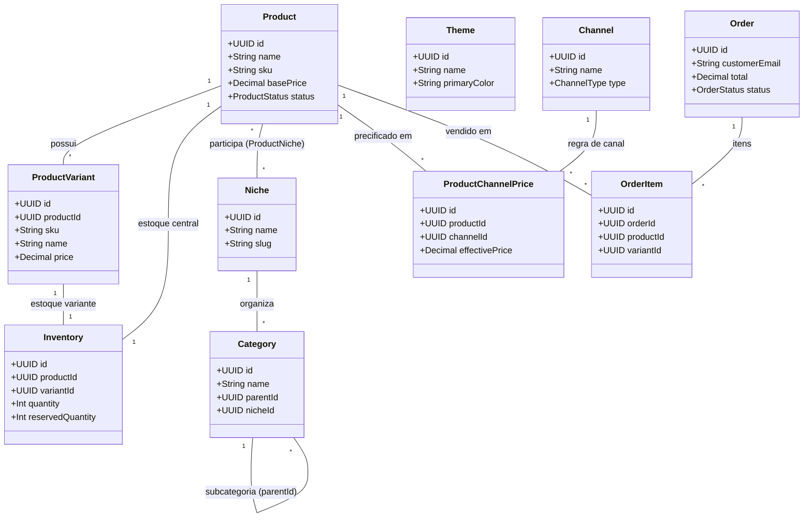

# EUSOU_MASTER_ARCHITECTURE.md
# AUDITORIA MESTRA E CONSOLIDAÇÃO DA ARQUITETURA DEFINITIVA
**Data da Auditoria:** 13/10/2026 às 12:45 (Horário de Brasília)  
**Versão do Documento:** MASTER ARCHITECTURE AUDIT v1.0  
**Status de Execução:** READ-ONLY (Nenhum código, banco, rota ou schema alterado)  

---

## 1. RESUMO EXECUTIVO

O projeto **EuSou** atingiu um estado de maturidade funcional e operacional expressivo ao longo das fases **F0 a F17**:
- O núcleo de dados possui **54 tabelas estruturadas** e **13 migrations aplicadas** no Supabase PostgreSQL;
- Regras críticas de **estoque físico central (F7)**, **precificação de canais (F12)**, **afiliados (F6)**, **máquina de estados de pedidos e pagamentos (F16)** e **Disaster Recovery (F17)** estão homologadas com centenas de testes unitários e de integração;
- Uma planilha-modelo oficial (`modelo_importacao_produtos_eusou.xlsx`) foi construída com validação de dados em 23 colunas, compatível com as regras comerciais.

Contudo, esta auditoria mestra identifica um **desalinhamento conceitual e arquitetural crucial**:
> **O estado atual do frontend e das rotas públicas assume que o "EuSou" é uma loja virtual pública monomarca.**  
> **Na arquitetura comercial definitiva, o EuSou é uma CENTRAL ADMINISTRATIVA PRIVADA, enquanto as lojas públicas pertencem aos NICHOS INDEPENDENTES.**

Este documento consolida o mapeamento exaustivo da arquitetura, aponta as lacunas estruturais, estabelece o que deve ser rigorosamente preservado e define a classificação da arquitetura atual.

---

## 2. VISÃO DO NEGÓCIO

1. **A Matriz:** O **EuSou** é uma central privada de inteligência, operação, fabricação e distribuição comercial.
2. **As Unidades Comerciais:** Os **Nichos** (ex.: *Pet Shop*, *Decoração*, *Love Store*, etc.) são marcas e lojas comerciais autônomas.
3. **O Consumidor Final:** O cliente que compra um porta-chaves de gato em uma vitrine de Pet Shop **nunca** deve ver a marca "EuSou", painéis administrativos, outros nichos, custos de produção ou estoques centrais.
4. **O Estoque e o Custo:** O estoque físico e o custo de produção são **únicos e centralizados** na matriz EuSou, abastecendo todos os nichos e canais sem duplicar a contagem de peças físicas.

---

## 3. ARQUITETURA CONCEITUAL: AS TRÊS CAMADAS

```
┌────────────────────────────────────────────────────────────────────────┐
│                   CAMADA 1 — CENTRAL EUSOU (PRIVADA)                   │
│  Gestão Central: Produtos, Variantes, Custos, Estoque Físico, Produção,│
│   Preços Base, Canais, Usuários, Permissões RBAC, Logs de Auditoria    │
└───────────────────────────────────┬────────────────────────────────────┘
                                    │
                                    ▼
┌────────────────────────────────────────────────────────────────────────┐
│                 CAMADA 2 — PORTAL DE NICHOS (PRIVADA)                  │
│    Área Administrativa Contextual: Configuração das Unidades Comerciais│
│     (Pet Shop, Decoração...), Vinculação de Catálogos, Temas e Canais  │
└───────────────────────────────────┬────────────────────────────────────┘
                                    │
                    ┌───────────────┴───────────────┐
                    ▼                               ▼
┌───────────────────────────────────┐ ┌──────────────────────────────────┐
│   CAMADA 3 — LOJA NICHO A (PÚBLICA)│ │  CAMADA 3 — LOJA NICHO B (PÚBLICA│
│   Domínio: petshop-oficial.com.br │ │   Domínio: decoracao-home.com.br │
│   Template / Tema: Pet Shop Theme │ │   Template / Tema: Minimal Decor │
│   Catálogo & Vitrine: Pets/Gatos  │ │   Catálogo & Vitrine: Quadros    │
│   Marca Pública: "Pet Love Store" │ │   Marca Pública: "Ateliê Decor"  │
└───────────────────────────────────┘ └──────────────────────────────────┘
```

---

## 4. DIAGRAMA GERAL DE DADOS E RELACIONAMENTOS



---

## 5. CENTRAL EUSOU (CAMADA 1)
- **Natureza:** 100% Privada e Administrativa.
- **Acesso:** Exclusivo para usuários autenticados com role `admin` (Guards JWT + RolesGuard).
- **Responsabilidades:**
  - Cadastro mestre de `Product` e `ProductVariant` (uma única vez na vida);
  - Controle de `costBasis` e fichas de `ProductionProfile`;
  - Saldo físico real em `Inventory` e histórico em `StockMovement`;
  - Gestão de usuários, auditoria em `AuditLog`, backups e restauração DR (F17).

---

## 6. PORTAL DE NICHOS (CAMADA 2)
- **Natureza:** Privada (Gestão Interna das Unidades Comerciais).
- **Responsabilidades:**
  - Ativação de novos nichos de mercado;
  - Associação de quais produtos mestres estão habilitados para cada nicho;
  - Configuração do tema visual (`Theme`), logotipo e identidade do nicho;
  - Parametrização dos canais comerciais autorizados para o nicho (Atacado, Varejo, Afiliados, Marketplaces).

---

## 7. NICHOS (UNIDADE COMERCIAL)
- **Conceito:** O Nicho **não é uma simples categoria ou tag**, mas uma unidade de negócio completa.
- **Relação com Entidades:**
  - `Niche` $\rightarrow$ `Category` (Categorias pertencem ao nicho);
  - `Niche` $\rightarrow$ `Catalog` (Catálogos e vitrines pertencem ao nicho);
  - `Niche` $\rightarrow$ `ProductNiche` (Produtos vinculados ao nicho);
  - `Niche` $\rightarrow$ `CommissionRule` (Comissões de afiliados específicas por nicho).

---

## 8. DOMÍNIOS PRÓPRIOS POR NICHO
### Diagnóstico da Arquitetura Atual:
- **Estado Atual:** O backend NestJS e o frontend Vite atendem exclusivamente em rotas relativas (`/`, `/produtos`, `/carrinho`). O frontend detecta nicho via rota ou LocalStorage (`eusou_active_niche`).
- **Lacuna Arquitetural:** Não existe no banco a entidade `NicheDomain` ou campo `domain` no modelo `Niche`.
- **Evolução Necessária (Futura):**
  1. Campo `domain` (ou tabela `NicheDomain`) em `Niche` (ex.: `loja.felinodelia.com.br`);
  2. Middleware no backend (`DomainContextMiddleware`) lendo o header `Host` da requisição HTTP e injetando o `nicheId` automaticamente no contexto;
  3. Suporte no frontend para inicializar o template e produtos baseado no `window.location.hostname`.

---

## 9. TEMPLATES E TEMAS (`Theme`)
### Diagnóstico:
- **Estado Atual:** A entidade `Theme` (F4) já existe no Prisma (`primaryColor`, `secondaryColor`, `font`, `buttonStyle`, `cardStyle`, `bannerStyle`, `productsPerRow`).
- **Desacoplamento:** `Theme` está modelado separadamente de `Niche`, o que está **rigorosamente correto**. Um mesmo template pode ser instanciado ou reutilizado por múltiplos nichos.
- **Lacuna:** O modelo `Niche` ainda não possui a chave estrangeira direta `themeId` para selecionar o tema ativo da sua loja pública.

---

## 10. PRODUTO CENTRAL
### Diagnóstico:
- **Estado Atual:** `Product` é rigorosamente uma entidade central e única (com `sku`, `name`, `basePrice`, `description`).
- **Evidência:** O relacionamento com nichos é N:N via `ProductNiche`. Um produto físico nunca é duplicado para existir em outro nicho.
- **Preservação:** Manter 100% intacto.

---

## 11. CUSTO CENTRAL
### Diagnóstico:
- **Estado Atual:** O custo é tratado como atributo produtivo central (`costBasis` no F12 e parâmetros de filamento/tempo no F7).
- **Separação:** Custo não é preço de venda. O custo não varia por nicho ou marketplace, pertencendo à fábrica/operação central.

---

## 12. ESTOQUE FÍSICO CENTRAL (F7)
### Diagnóstico:
- **Estado Atual:** `Inventory` armazena a contagem física única (`quantity`) por `productId` e `variantId`.
- **Comportamento:** Quando um pedido é confirmado e pago (`PAID`), a saída ocorre no estoque central via `StockMovement`, garantindo que uma venda em qualquer canal dê baixa no mesmo montante físico.

---

## 13. RESERVA / ALOCAÇÃO DE ESTOQUE (FUTURO)
- **O que já existe:** `Inventory.reservedQuantity` já reserva peças durante o processamento de pedidos.
- **O que é futuro:** Alocação de cotas lógicas de estoque pré-destinadas a nichos específicos (ex.: "reservar 20 peças para a campanha do Nicho Pet"). A arquitetura atual permite adicionar essa tabela de alocação futura sem quebrar o estoque físico central.

---

## 14. PREÇOS E O PONTO CRÍTICO: PREÇO POR NICHO
### Diagnóstico Crítico do Motor F12:
- **Como o F12 está modelado hoje:**
  - `ProductChannelPrice` possui chave única `[productId, channelId, variantId]`.
  - Ou seja: atualmente existe suporte a **Produto + Canal + Preço**.
- **Onde está a limitação:**
  - O `ProductChannelPrice` **não possui** o campo `nicheId`.
  - Se o Produto X for vendido no canal "Loja Própria" do Nicho Pet e no canal "Loja Própria" do Nicho Decoração, o modelo atual assume o mesmo preço de canal para ambos.
- **Solução Arquitetural Futura (Sem alterar código agora):**
  - Quando for implementada a segregação de preços por nicho, o relacionamento deverá evoluir para `[productId, nicheId, channelId, variantId]`.

---

## 15. CANAIS COMERCIAIS (ATACADO, VAREJO, LOJA, MARKETPLACES)
- **Conceito:** O Canal representa o meio de comercialização (`OWN_STORE`, `MERCADO_LIVRE`, `SHOPEE`, etc.).
- **Atacado e Varejo:** Devem ser tratados como perfis de canais/regras comerciais, e não como campos rígidos em `Product`.

---

## 16. AFILIADOS (F6)
- **Estado Atual:** O módulo de afiliados rastreia códigos (`affiliateCode`), gera comissões em `AffiliateConversion` e associa comissões a pedidos.
- **Aderência:** O modelo `CommissionRule` já possui relação com `Category` e `Niche`, estando perfeitamente apto para regras contextuais de nicho.

---

## 17. MARKETPLACES (F9, F10, F13)
- **Estado Atual:** Conectores com abstração de canais, mapeamento de atributos e reconciliação assíncrona de pedidos/preços.
- **Isolamento:** Os marketplaces atuam estritamente como canais de distribuição de saída; nenhum canal é proprietário de produtos.

---

## 18. PEDIDOS (`Order` - F5)
### Diagnóstico de Rastreabilidade Comercial:
- **O que o Order armazena hoje:** Dados do cliente, endereço completo, total, subtotal, frete, `affiliateCode`, snapshot de produtos e variantes.
- **Lacuna Identificada:** A entidade `Order` **não armazena o `nicheId` nem o `domain` de origem da compra**.
- **Impacto:** O administrador não consegue filtrar no dashboard vendas consolidadas por Nicho (ex.: quanto o Nicho Pet vendeu vs Nicho Decoração).
- **Proposta Futura:** Adicionar `nicheId` opcional em `Order` para rastreamento de origem da receita.

---

## 19. PAGAMENTOS (F16)
- **Estado Atual:** Totalmente desacoplado do modelo de negócio. `PaymentService` gerencia provedores via interface (`PaymentProvider`), com máquina de estados rigorosa (pagamento falho não confirma pedido e não baixa estoque).
- **Pendência Externa:** A homologação do Mercado Pago em Sandbox (F16-B) permanece com **STATUS B** devido a falha interna do Sandbox do gateway, aguardando virada de credenciais de produção.

---

## 20. ADMINISTRAÇÃO E PERMISSÕES (RBAC)
- **Estado Atual:** Guardas `@UseGuards(JwtAuthGuard, RolesGuard)` protegem todas as rotas de backend.
- **Frontend:** O acesso a `/admin/*` exige login como `admin`.
- **Ressalva de UX Pública:** No rodapé da loja pública e no cabeçalho atual, a marca "EuSou" aparece como nome da loja, o que deve ser substituído pelo nome e logo do Nicho no contexto da loja pública.

---

## 21. ROTAS DO SISTEMA
### Rotas Privadas (Camada 1 e 2):
- `/auth/*` (Login, Refresh, Me)
- `/admin/*` (Dashboard, Produtos, Nichos, Categorias, Catálogos, Pedidos, Estoque, Produção, Afiliados, Marketplaces)
- Todas as APIs REST administrativas (`/products`, `/categories`, `/niches`, `/inventory`, `/pricing`, `/orders`)

### Rotas Públicas (Camada 3):
- `/public/*` (`/public/home`, `/public/products`, `/public/catalogs`, `/public/categories`)
- `/checkout` e `/carrinho` (Fluxo de compra do consumidor)
- `/affiliate` (Portal de auto-cadastro do afiliado)

---

## 22. SEO E IDENTIDADE VISUAL
- **Estado Atual:** O arquivo `index.html` e a estrutura do frontend utilizam título e meta tags estáticos ("EuSou").
- **Necessidade Futura:** As páginas da Camada 3 devem injetar dinamicamente `title`, `meta description`, `favicon` e Open Graph baseados na identidade do Nicho ativo.

---

## 23. PRODUÇÃO (F7)
- **Estado Atual:** Fichas técnicas em `ProductionProfile` e filas de impressão em `ProductionJob`.
- **Isolamento:** 100% isolado da loja pública. O consumidor final não visualiza nem interage com filas de fabricação ou tempo de fatiamento.

---

## 24. DIVULGAÇÃO & PROMOÇÕES (F8)
- **Estado Atual:** Geração de campanhas, links curtos, cards e mensagens para WhatsApp via `PromoHub`.
- **Aderência:** Compatível com geração de links que apontam para rotas de produtos e catálogos.

---

## 25. MAPA ARQUITETURAL: CENTRAL vs CONTEXTUAL vs FUTURO

| Entidade / Recurso | Nível de Gestão | Contexto de Operação | Status Atual |
| :--- | :---: | :---: | :---: |
| **Product & Variant** | Central EuSou | Matriz Privada | **Implementado e Homologado** |
| **Inventory (Físico)** | Central EuSou | Matriz Privada | **Implementado e Homologado** |
| **CostBasis (Custo)** | Central EuSou | Matriz Privada | **Implementado e Homologado** |
| **ProductionJob (3D)** | Central EuSou | Matriz Privada | **Implementado e Homologado** |
| **Theme (Templates)** | Central EuSou | Reutilizável por Nichos | **Implementado e Homologado** |
| **Niche (Marca/Loja)** | Central EuSou | Unidade Comercial | **Implementado e Homologado** |
| **Category & Hierarchy**| Contextual por Nicho | Vinculado a Niche | **Implementado e Homologado** |
| **Catalog & Collection**| Contextual por Nicho | Vitrine do Nicho | **Implementado e Homologado** |
| **ProductChannelPrice** | Contextual por Canal | F12 Multicanal | **Implementado (Canal-only)** |
| **Order & Payment** | Transacional | Matriz Privada | **Implementado e Homologado** |
| **Affiliate & Links** | Comercial Distribuído | Multicanal | **Implementado e Homologado** |
| **Domain por Nicho** | Contextual por Nicho | Resolução HTTP/Host | **Futuro (Não Implementado)** |
| **Niche no Order** | Transacional | Origem da Venda | **Futuro (Lacuna Mapeada)** |
| **Reserva por Nicho** | Alocação de Estoque | Lógica de Estoque | **Futuro (Não Implementado)** |

---

## 26. AUDITORIA EXAUSTIVA DAS FASES F0 A F17

| Fase | Título / Escopo | Classificação Arquitetural | Diagnóstico Resumido |
| :--- | :--- | :---: | :--- |
| **F0** | Setup Base & Infraestrutura | **ALINHADO** | Estrutura limpa NestJS + Prisma + Vite. |
| **F1** | Autenticação & RBAC | **ALINHADO** | JWT, Refresh Tokens, proteção de rotas privadas. |
| **F2A** | Modelos de Produtos | **ALINHADO** | Produto central único e normalizado. |
| **F2B** | Variantes, Atributos & Mídias | **ALINHADO** | Múltiplas variantes ligadas a SKUs físicos. |
| **F3** | Nichos, Categorias & Tags | **PARCIALMENTE ALINHADO** | Nicho e hierarquia de categorias existem; falta vincular domínio e template ao nicho. |
| **F4** | Catálogos, Coleções & Temas | **PARCIALMENTE ALINHADO** | Entidades Theme e Catalog existem; falta vincular Theme ao Niche. |
| **F5** | Pedidos & Carrinho | **PARCIALMENTE ALINHADO** | Pedido congela preços e itens; falta gravar `nicheId` de origem no Order. |
| **F6** | Sistema de Afiliados | **ALINHADO** | Links, tracking e comissões por categoria/nicho funcionais. |
| **F7** | Estoque Físico & Produção | **ALINHADO** | Estoque físico centralizado e atômico. |
| **F8** | Hub de Divulgação (PromoHub) | **ALINHADO** | Geração de links e materiais promocionais. |
| **F9** | Hub de Marketplaces (Core) | **ALINHADO** | Canais e eventos assíncronos desacoplados. |
| **F10** | Conector Mercado Livre | **ALINHADO** | Estrutura pronta; aguarda homologação externa. |
| **F11A**| Painel Comercial do Administrador| **ALINHADO** | Visualização centralizada dos indicadores. |
| **F11B**| Portal do Afiliado | **ALINHADO** | Acesso restrito com dados do afiliado. |
| **F12** | Motor de Precificação Multicanal| **PARCIALMENTE ALINHADO** | Calcula preços por Canal perfeitamente; não segrega por Nicho. |
| **F13A**| Sincronização de Estoque ML | **ALINHADO** | Baixa atômica de estoque em vendas externas. |
| **F13B**| Mapeamento de Categorias ML | **ALINHADO** | Tradução taxonômica funcional. |
| **F14** | Reconciliação Financeira ML | **ALINHADO** | Auditoria de repasses de marketplaces. |
| **F14-H**| Homologação End-to-End | **ALINHADO** | 283 testes de integração automatizados. |
| **F15-A**| Performance & Índices | **ALINHADO** | Banco com 200 índices e consultas otimizadas. |
| **F15-B**| Segurança & Hardening | **ALINHADO** | Sanitização, rate limit e headers seguros. |
| **F15-C**| Auditoria de Código & Lints | **ALINHADO** | 0 erros de compilação e TypeScript estrito. |
| **F15-D**| Auditoria Comercial & DR | **ALINHADO** | Base homologada para recuperação. |
| **F16-A**| Checkout & Pagamentos (Base) | **ALINHADO** | Máquina de estados desacoplada e segura. |
| **F16-B**| Mercado Pago TEST (Real) | **PENDENTE EXTERNO** | Status B devido a erro 500 interno do Sandbox do MP. |
| **F17-A**| Backup, Restauração & DR | **ALINHADO** | Restore real comprovado em schema isolado (Status B). |

---

## 27. COMPATIBILIDADE DA PLANILHA OFICIAL DE IMPORTAÇÃO
- O modelo [`modelo_importacao_produtos_eusou.xlsx`](file:///d:/eusou/modelo_importacao_produtos_eusou.xlsx) auditado na fase anterior mantém **100% de coerência** com a arquitetura mestra:
  - Não inclui campos indevidos como Domínio ou Template (que pertencem ao Nicho);
  - Trata `CUSTO` como atributo central;
  - Trata `ESTOQUE_INICIAL` como saldo físico central;
  - Trata `VAREJO`, `ATACADO` e marketplaces como ofertas comerciais/canais;
  - Permite produtos base e múltiplas variantes de cor/tamanho sem duplicar `Product`.

---

## 28. O QUE ESTÁ CORRETO E DEVE SER PRESERVADO
1. **Produto e Variante Central:** Manter intocadas as entidades `Product` e `ProductVariant`.
2. **Estoque Central (F7):** Manter a centralização de `Inventory` e histórico em `StockMovement`.
3. **Custo Central:** Manter o custo dissociado dos preços de venda.
4. **Desacoplamento de Pagamentos (F16):** Manter a separação estrita entre `Order` e `Payment`.
5. **Autenticação e RBAC (F1):** Manter o bloqueio seguro do backoffice EuSou.
6. **Mecanismo de Disaster Recovery (F17):** Manter os scripts de dump, hash SHA-256 e restore isolado.

---

## 29. O QUE ESTÁ DESALINHADO OU INCOMPLETO
1. **Loja Pública Monomarca no Frontend:**  
   - *Problema:* O frontend atual (`App.tsx`, `Header.tsx`, `Footer.tsx`) expõe a marca "EuSou" ao consumidor final.  
   - *Impacto:* Quebra a ilusão de marca do Nicho (ex.: cliente compra num pet shop mas vê "EuSou").  
   - *Prioridade:* **Alta (antes da primeira venda ao público)**.
2. **Ausência de Domínio em `Niche`:**  
   - *Problema:* Não há campo ou entidade para associar domínios próprios aos nichos.  
   - *Prioridade:* **Média (pode operar com subdomínio ou slug no primeiro lançamento)**.
3. **Ausência de `nicheId` em `Order`:**  
   - *Problema:* O pedido não registra de qual nicho partiu a venda.  
   - *Prioridade:* **Média**.
4. **Preço por Canal sem Segregação por Nicho no F12:**  
   - *Problema:* `ProductChannelPrice` não possui chave `nicheId`.  
   - *Prioridade:* **Baixa para o primeiro nicho (Pet Shop); Alta para quando houver o segundo nicho**.

---

## 30. O QUE DEVE FICAR PARA O FUTURO (NÃO FAZER AGORA)
1. **Múltiplos Domínios Públicos Ativos:** O primeiro lançamento pode operar sob um único domínio com o nicho inicial (*Pet Shop*).
2. **Reserva Avançada de Estoque por Nicho:** O estoque físico central atende com perfeição o primeiro momento.
3. **Módulo de Emissão Fiscal (NF-e):** Faturamento manual inicial no portal do MEI/Sefaz.
4. **Expansão para Novos Marketplaces (Shopee, TikTok Shop):** Ativação externa após a loja própria operar.
5. **Criação de Novos Nichos:** Focar 100% da energia no nicho piloto antes de abrir o segundo.

---

## 31. DEPENDÊNCIAS E ORDEM LÓGICA DE EVOLUÇÃO
```
1. Importação Oficial do Catálogo do Nicho Piloto (Pet Shop)
   ↓
2. Desacoplamento da Identidade Visual da Loja Pública (Substituir EuSou pelo Nicho na Vitrine)
   ↓
3. Configuração de Regras de Frete no Checkout
   ↓
4. Homologação do Pagamento em Produção (Mercado Pago Produção)
   ↓
5. Deploy em Nuvem e Apontamento de Domínio
   ↓
6. Primeira Venda Real
   ↓
7. Expansão para Segundo Nicho e Múltiplos Domínios
```

---

## 32. DECISÕES ESTRUTURAIS PENDENTES DE APROVAÇÃO DA ADMINISTRADORA

Apenas **3 decisões estratégicas** precisam da validação da Paula:

1. **Identidade Pública da Primeira Loja:**  
   *A loja pública que os clientes acessarão no lançamento terá o nome oficial de **"Felinodelia"** (ou outro nome do nicho pet), ocultando completamente a marca "EuSou" para o consumidor?*
2. **Política de Frete para o Lançamento:**  
   *A loja iniciará com **Frete Fixo** (ex.: R$ 15,00 para todo o Brasil), **Frete Grátis** acima de um valor determinado (ex.: R$ 99,00) ou integração com API dos Correios/Melhor Envio?*
3. **Ambiente de Pagamento para Teste de Homologação:**  
   *Podemos virar as chaves do Mercado Pago para **Produção** para testar uma compra real de R$ 1,00 (PIX ou Cartão) e fazer o estorno em seguida, superando o bloqueio do Sandbox?*

---

## 33. CLASSIFICAÇÃO FINAL DA ARQUITETURA

> **CLASSIFICAÇÃO OFICIAL: B — ARQUITETURA É TOTALMENTE VIÁVEL, COM PEQUENOS DESALINHAMENTOS DE CAMADA PÚBLICA QUE DEVEM SER AJUSTADOS ANTES DO LANÇAMENTO**

### Justificativa:
O núcleo do backend, banco de dados, estoque central, precificação e regras de negócio estão em estado de excelência técnica (100% alinhados à visão de central administrativa). O único desalinhamento existente reside na **Camada 3 (Frontend da Loja Pública)**, que atualmente ainda exibe o nome "EuSou" e opera como loja única, necessitando apenas da separação visual para assumir a identidade autônoma do nicho piloto.
