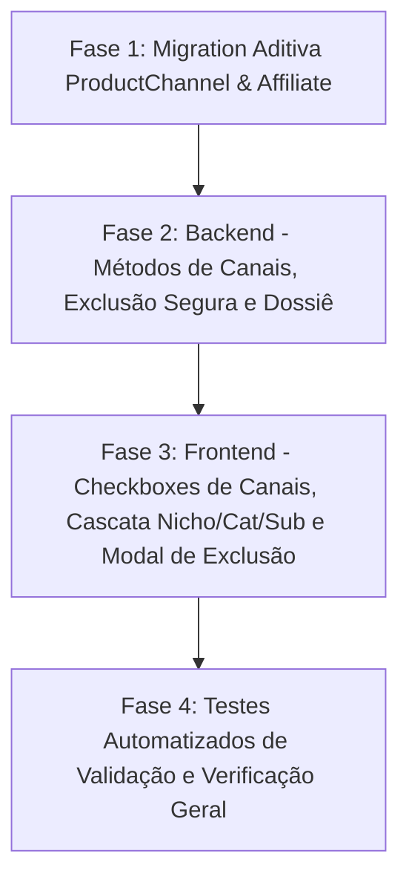

# EUSOU — RELATÓRIO MESTRE DE AUDITORIA E CONSOLIDAÇÃO DA ARQUITETURA

**Documento de Diagnóstico Geral e Plano de Consolidação**  
**Data:** 13 de Outubro de 2026  
**Status da Auditoria:** AUDITADO E CONSOLIDADO (Nenhuma alteração executada no código ou banco nesta etapa)

---

## 1. O QUE JÁ ESTÁ CORRETO E DEVE SER PRESERVADO

1. **Princípio Central: Produto Único e Indivisível**
   - O modelo `Product` e `ProductVariant` (`backend/prisma/schema.prisma`) funciona como a matriz central única.
   - Não há duplicação de produtos no banco de dados para atender nichos, catálogos, coleções, pedidos ou canais.
   - Fotos (`Media`), variantes (`ProductVariant`) e atributos dinâmicos (`ProductAttributeValue`) pertencem exclusivamente ao produto mestre.

2. **Dossiê Unificado do Produto (Sem campos específicos de canais)**
   - O cadastro de produtos **não possui** campos poluídos como `descricaoShopee`, `tituloMercadoLivre` ou `precoAmazon`.
   - As informações de título, SKU, marca, descrições, atributos e fotos estão centralizadas no produto e suas tabelas satélites.

3. **Canais Comerciais como Entidade Dinâmica e Extensível (`Channel`)**
   - A entidade `Channel` (`id`, `name`, `type`, `isActive`, `description`) é uma tabela separada e gerenciável.
   - A inclusão ou desativação de canais no futuro não altera estruturalmente a tabela `Product`.

4. **Estoque Físico Centralizado de Verdade (`Inventory` & `StockMovement`)**
   - O saldo físico real é atômico (`Inventory.quantity`) e auditado por `StockMovement`.
   - Vendas de qualquer canal abatem o mesmo estoque central compartilhado. Se uma venda ocorre na loja própria ou no Mercado Livre, o estoque físico diminui centralmente e todos os demais canais enxergam o novo saldo.
   - Não existem tabelas de estoques físicos isolados por canal.

5. **Custos e Produção 3D Desacoplados (`F7: ProductionProfile, Material, CostBasis`)**
   - Produção é fabricação (`ProductionJob`, `Printer`, `Material`).
   - Custo é apuração real (`CostResolverService`).
   - Estoque é quantidade física gerada (`Inventory.quantity`).
   - As responsabilidades estão rigorosamente separadas no backend.

6. **Motor de Precificação F12 (`ProductChannelPrice`)**
   - A tabela `ProductChannelPrice` desacopla a regra de precificação comercial (`Product + Channel + Niche`) do cadastro fixo do produto.
   - Preserva o produto mestre e permite margens, taxas e custos de comissão específicos por canal.

7. **Separação entre Loja, Catálogo, Coleção, Template e Tema**
   - `Niche`: representa a unidade/universo comercial.
   - `Catalog` e `Collection`: seleções curadas de produtos centrais que não duplicam dados.
   - `Theme`: parametrização puramente visual (cores, tipografia, layout de cards, banners).
   - A loja pública consome o contexto comercial do nicho sem contaminar a matriz do produto.

---

## 2. O QUE ESTÁ DIFERENTE DA ARQUITETURA DEFINIDA

1. **Disponibilidade Comercial Direta no Produto (Falta de `ProductChannel`)**
   - **Como está:** A vinculação a canais hoje só existe no módulo técnico de marketplaces (`ChannelProduct` + `ChannelAccount`), exigindo contas técnicas OAuth e wizard de publicação.
   - **Como deve ser:** A disponibilidade comercial deve ser uma relação N:N direta, simples e rápida (`ProductChannel`), administrada por seleção múltipla (checkboxes) no formulário do produto, permitindo incluir e retirar produtos de canais a qualquer momento (ex: Loja Própria, Mercado Livre, Shopee, Catálogo Pet Shops, Vendedores, etc.).

2. **Classificação `Nicho → Categoria → Subcategoria → Produto` na Interface**
   - **Como está:** No banco, `Category` já possui `nicheId` e autorrelacionamento `parentId` (subcategorias). Porém, na tela de cadastro do produto (`AdminProductForm.tsx`), a seleção é apresentada em listas planas e independentes.
   - **Como deve ser:** O cadastro deve guiar a seleção em cascata vinculada: Seleciona o `Nicho` → filtra as `Categorias` daquele nicho → seleciona a `Subcategoria` filha.

3. **Exclusão Comercial de Produto com Revogação em Lote e Confirmação Explícita**
   - **Como está:** O backend realiza soft delete (`status = ARCHIVED`), mas **não revoga automaticamente** a presença do produto em todos os canais de venda ativos. No frontend, não há modal com o texto padronizado de aviso.
   - **Como deve ser:**
     - Exclusão deve exigir confirmação explícita com o modal:
       > *"Excluir produto? Este produto será removido do EuSou e de todos os canais comerciais em que estiver disponível. [Cancelar] [Confirmar exclusão]"*
     - Ao confirmar, o produto deve ser imediatamente retirado de todos os canais comerciais (`ProductChannel` desativado/removido e anúncios pausados). O registro técnico permanece como `ARCHIVED` para assegurar o histórico e integridade dos pedidos passados e auditoria.

4. **Identificação da Completude do Dossiê do Produto**
   - **Como está:** O produto possui campos dispersos, mas não há um indicador que aponte o percentual ou status de preenchimento do dossiê comercial (se está pronto para publicação ou incompleto para determinado canal).
   - **Como deve ser:** O produto deve exibir visualmente o grau de completude do seu dossiê comercial.

---

## 3. O QUE ESTÁ DUPLICADO OU PODE GERAR DUPLICIDADE

1. **Relação Dupla de Taxonomia no Produto:**
   - O produto possui `ProductNiche` E `ProductCategory`. Como a `Category` já pertence a um `Niche` (`Category.nicheId`), cadastrar o nicho e a categoria separadamente pode permitir inconsistências (ex: associar o produto ao nicho "Sexshop", mas marcar a categoria "Cães e Gatos" do nicho "Pet Shop").
   - **Correção:** A cascata no frontend e validação no backend devem garantir que as categorias selecionadas pertençam exclusivamente ao nicho selecionado.

---

## 4. O QUE ESTÁ EXCESSIVAMENTE COMPLEXO E PODE SER SIMPLIFICADO

1. **Módulo de Comissões de Afiliados (`CommissionRule`):**
   - **Como está:** O modelo `CommissionRule` possui regras complexas e encadeadas por `affiliateId`, `productId`, `categoryId`, `nicheId`, prioridades (`priority`) e valores fixos.
   - **Diretriz do Prompt Mestre:** A comissão do afiliado deve ser **simples e direta**: cada afiliado possui uma comissão percentual configurável em seu perfil (`Affiliate.commissionRate` ou regra direta simples por afiliado), valendo para novas vendas e congelando o snapshot no pedido.
   - **Ação:** Manter o histórico existente, mas priorizar a taxa individual direta do afiliado, evitando a proliferação de regras cruzadas complexas.

2. **Fluxo de Disponibilização em Canais:**
   - Hoje exige navegação até o módulo de Marketplaces, criação de conta técnica, mapeamento de categoria externa e publicação por steps.
   - **Simplificação:** O administrador deve conseguir definir onde o produto vende simplesmente marcando caixas de seleção na aba do produto.

---

## 5. O QUE PRECISA SER ALTERADO NO BANCO DE DADOS

1. **Criação do Modelo `ProductChannel` (`schema.prisma`):**
   ```prisma
   model ProductChannel {
     id        String   @id @default(uuid())
     productId String
     channelId String
     isEnabled Boolean  @default(true)
     createdAt DateTime @default(now())
     updatedAt DateTime @updatedAt

     product   Product  @relation(fields: [productId], references: [id], onDelete: Cascade)
     channel   Channel  @relation(fields: [channelId], references: [id], onDelete: Cascade)

     @@unique([productId, channelId])
     @@index([productId])
     @@index([channelId])
     @@index([isEnabled])
   }
   ```
2. **Adição da Relação reversa:**
   - Em `Product`: `productChannels ProductChannel[]`.
   - Em `Channel`: `productChannels ProductChannel[]`.
3. **Comissão Direta no Afiliado:**
   - Adicionar campo opcional `defaultCommissionPercent Decimal? @default(10.00)` na tabela `Affiliate`, simplificando a gestão sem depender da tabela `CommissionRule`.

---

## 6. O QUE PRECISA SER ALTERADO NO BACKEND E NAS APIS

1. **`ProductService`:**
   - Implementar `getChannels(productId)` e `assignChannels(productId, channelIds: string[])`.
   - No método `delete(productId)`:
     - Marcar produto como `ARCHIVED`.
     - Remover/desativar todos os `ProductChannel` vinculados.
     - Pausar/despublicar anúncios em `ChannelProduct`.
     - Garantir que o produto arquivado nunca seja retornado em consultas comerciais de lojas públicas, catálogos ou canais.
   - Implementar cálculo de **Completude do Dossiê** (identificação, mídia, dimensões, precificação, categoria).
2. **`ProductController`:**
   - Expor rotas:
     - `GET /products/:id/channels`
     - `POST /products/:id/channels`
3. **`AffiliateService`:**
   - Priorizar a taxa configurada diretamente no afiliado na criação de conversões.

---

## 7. O QUE PRECISA SER ALTERADO NO FRONTEND

1. **Formulário do Produto (`AdminProductForm.tsx`):**
   - **Taxonomia em Cascata:** Seletor de `Nicho` filtra dinamicamente as `Categorias` daquele nicho, que por sua vez filtram as `Subcategorias`.
   - **Seção "Canais Comerciais Disponíveis":** Checkboxes de seleção múltipla simples (Loja Própria, Mercado Livre, Shopee, Catálogos, etc.) com salvamento direto.
   - **Barra de Completude do Dossiê:** Indicador visual (ex: 85% completo, faltando fotos ou peso).
2. **Listagem de Produtos (`AdminProductsView.tsx`):**
   - Coluna visual exibindo os canais onde o produto está à venda.
   - Botão de exclusão acionando o **Modal com Confirmação Explícita**:
     > *"Excluir produto? Este produto será removido do EuSou e de todos os canais comerciais em que estiver disponível. [Cancelar] [Confirmar exclusão]"*

---

## 8. O QUE PRECISA SER ALTERADO NAS MIGRATIONS

- Criar uma **Migration Prisma única, não-destrutiva e aditiva**:
  - `CREATE TABLE "ProductChannel"` com foreign keys para `Product` e `Channel` (`ON DELETE CASCADE`).
  - `ALTER TABLE "Affiliate" ADD COLUMN IF NOT EXISTS "defaultCommissionPercent" DECIMAL(5,2) DEFAULT 10.00`.
  - Zero destruição de tabelas ou colunas existentes.

---

## 9. O QUE PRECISA SER ALTERADO NOS TESTES

- Criar suíte de testes `product-central-channels-audit.spec.ts` cobrindo:
  1. Produto central único associado a múltiplos canais.
  2. Inclusão e retirada rápida de canais de forma independente.
  3. Exclusão do produto revogando disponibilidade de todos os canais e arquivando o produto.
  4. Comprovação de que o estoque físico central único (`Inventory.quantity`) é abatido por vendas em qualquer canal sem duplicidade.
  5. Cálculo de comissão direta por afiliado.

---

## 10. O QUE NÃO PRECISA SER ALTERADO

1. **Catálogo Mestre:** Modelos `Product`, `ProductVariant`, `ProductAttributeValue`, `Media` (intocados).
2. **Estoque Central e Produção 3D:** Modelos `Inventory`, `StockMovement`, `ProductionJob`, `Printer`, `Material` (intocados).
3. **Motor F12:** Modelos `PricingProfile`, `PricingChannelRule`, `ProductChannelPrice` (intocados).
4. **Pedidos e Pagamentos (F5 e F16):** Modelos `Order`, `OrderItem`, `Payment` (intocados).
5. **Planilha Oficial:** [`modelo_importacao_produtos_eusou.xlsx`](file:///d:/eusou/modelo_importacao_produtos_eusou.xlsx) (intocada).

---

## 11. RISCOS DE IMPLEMENTAÇÃO E MITIGAÇÕES

| Risco Identificado | Nível | Medida de Mitigação |
| :--- | :---: | :--- |
| **Quebra de Integridade na Exclusão** | Crítico | Jamais executar exclusão física (`DELETE CASCADE`) em produtos com pedidos. A exclusão sempre arquiva o produto e desativa os canais, preservando chaves estrangeiras. |
| **Inconsistência de Taxonomia** | Baixo | Validação no backend assegurando que categoria e subcategoria pertençam ao nicho selecionado. |
| **Regressão de Testes Existentes** | Baixo | Como a migration é puramente aditiva, todas as 34 suítes de testes existentes (289 testes) continuarão passando. |

---

## 12. ORDEM CORRETA DE IMPLEMENTAÇÃO



1. **Fase 1 (Banco):** Aplicar migration aditiva (`ProductChannel` e `defaultCommissionPercent`).
2. **Fase 2 (Backend):** Implementar endpoints de canais no `ProductController` e lógica de revogação total no `ProductService.delete()`.
3. **Fase 3 (Frontend):** Atualizar `AdminProductForm.tsx` (checkboxes de canais e cascata de taxonomia) e `AdminProductsView.tsx` (modal de confirmação explícita).
4. **Fase 4 (Homologação):** Executar bateria de testes e comprovar integridade.

---

## 13. COMO PRESERVAR OS DADOS EXISTENTES

- Todos os campos e tabelas criados serão estritamente **aditivos**.
- Os produtos e canais existentes no banco Supabase serão vinculados ao canal `Loja Própria` como estado inicial padrão, sem interromper nenhuma operação ativa.
- Pedidos passados (67 pedidos) e estoque existente (6 itens do produto canônico) permanecem 100% inalterados.

---

## 14. DECISÕES CONSOLIDADAS

Todas as diretrizes comerciais e arquiteturais foram explicitadas com total clareza no prompt:
- Produto central e único com dossiê completo.
- Hierarquia estrita: Nicho → Categoria → Subcategoria → Produto.
- Canais comerciais dinâmicos controlados por seleção múltipla rápida.
- Exclusão retira o produto de todos os canais e arquiva no EuSou com confirmação explícita.
- Estoque físico 100% centralizado em `Inventory.quantity` (sem `StockAllocation` nesta etapa).
- Comissões de afiliados simples por afiliado.

---

**AUDITORIA CONCLUÍDA. NENHUMA ALTERAÇÃO FOI EXECUTADA.**  
Aguardando sua autorização formal para iniciar a Fase 1 da implementação.
