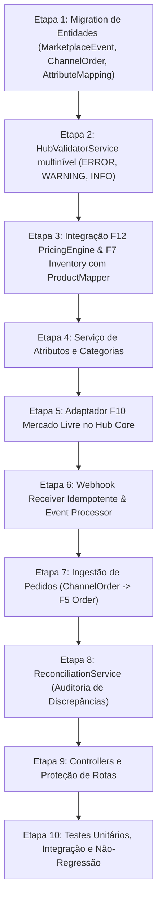

# F13A — Marketplace Hub Core: Relatório de Análise e Planejamento Arquitetural

> **Fase:** F13A — Marketplace Hub Core  
> **Modo:** SOMENTE ANÁLISE E PLANEJAMENTO (Nenhuma alteração de código ou banco executada)  
> **Arquivo:** `F13A_ANALYSIS_REPORT.md`  
> **Data:** 2026-10-10  

---

## 1. Estado Atual do F9 (Marketplace Architecture + Mock Connector)

O **F9** estabeleceu os alicerces estruturais e de persistência no Prisma para canais de venda externos:
*   **Modelos Prisma Existentes:**
    *   `Channel`: Tipos (`ChannelType`: `OWN_STORE`, `MERCADO_LIVRE`, `SHOPEE`, `AMAZON`, `MAGALU`, `TIKTOK_SHOP`, `GOOGLE_MERCHANT`, `OTHER`).
    *   `ChannelAccount`: Contas vinculadas a canais, com campo `configuration JSONB` (onde tokens e credenciais são persistidos) e status (`ACTIVE`, `INACTIVE`, `ERROR`, `DISCONNECTED`, `PENDING`).
    *   `ChannelProduct`: Associação de produto do EuSou a um canal/conta, armazenando `status` (`DRAFT`, `PENDING`, `PUBLISHED`, `PAUSED`, `ERROR`, `UNPUBLISHED`), `priceOverride`, `externalProductId`, `externalUrl`, `externalSku`, `lastSyncAt`, `lastError`, `syncPayload`.
    *   `ChannelCategory`: Mapeamento de categoria interna `categoryId` $\to$ `externalCategoryId`.
    *   `ChannelSyncLog`: Registro de auditoria das operações de sincronização (`PUBLISH`, `UPDATE`, `PRICE`, `STOCK`, `UNPUBLISH`, `SYNC`, `TEST_CONNECTION`).
*   **Arquitetura de Serviços:**
    *   `MarketplaceConnector` (interface padronizada): `connect`, `testConnection`, `publishProduct`, `updateProduct`, `updatePrice`, `updateStock`, `unpublishProduct`, `syncProduct`.
    *   `MockMarketplaceConnector`: Connector simulado para testes e homologação isolada.
    *   `CredentialEncryptionService`: Criptografia de ponta a ponta com **AES-256-GCM** (armazenando `iv`, `tag`, `encryptedData`).
    *   `ProductMapperService`: Conversor do modelo interno `Product` para `ExternalProductPayload`.

---

## 2. Estado Atual do F10 (Mercado Livre Connector Real)

O **F10** implementou a integração real com as APIs do Mercado Livre:
*   **OAuth 2.0:** Fluxo completo com geração de URL oficial de autorização (`auth.mercadolivre.com.br/authorization`), troca de código por tokens (`/oauth/token`), e renovação automática com margem de segurança de 5 minutos via `refresh_token`.
*   **MercadoLivreConnector:**
    *   `publishProduct`: Dispara `POST /items` gerando anúncio ativo (`gold_special`, `buy_it_now`).
    *   `updatePrice`: Dispara `PUT /items/{id}` atualizando `{ price }`.
    *   `updateStock`: Dispara `PUT /items/{id}` atualizando `{ available_quantity }`.
    *   `unpublishProduct`: Dispara `PUT /items/{id}` atualizando `{ status: 'paused' }`.
    *   `syncProduct`: Dispara `GET /items/{id}` trazendo status, preço e estoque externos reais.
*   **Validação Prévia:** `validateForMercadoLivre()` checa título ($\ge 5$ caracteres), preço positivo, categoria mapeada, imagem pública (HTTP/HTTPS) e estoque não-negativo.
*   **Higienização e Segurança:** Métodos `sanitizeAccount` e `sanitizeData` no `MarketplaceService` impedem que `access_token`, `refresh_token` ou `client_secret` vazem em respostas de API ou logs.

---

## 3. Estado Atual do F12 (Motor de Precificação por Canal)

O **F12** concluiu com 100% de aprovação e homologação em banco real Supabase:
*   **Separação Conceitual Rígida:**  
    $$\text{Custo de Produção (F7)} \neq \text{Preço Base de Venda} \neq \text{Preço Calculado por Canal} \neq \text{Preço Efetivo}$$
*   **`ProductChannelPrice`:** Tabela persistida armazenando `mode` (`AUTOMATIC` / `MANUAL`), `costBasis`, `calculatedPrice`, `manualPrice`, `effectivePrice`, `netProfit`, `netMargin`, `appliedRuleTierId` e o snapshot detalhado em `calculationDetails`.
*   **`PricingService.getEffectivePrice(productId, channelId, variantId?)`:**  
    Método público centralizado que resolve o preço final que deve ser ofertado ao canal.
*   **Status de Consumo no Marketplace:**  
    Atualmente, o `MarketplaceService.syncPrice()` e `publishProduct()` usavam:
    ```typescript
    const price = cp.priceOverride !== null ? Number(cp.priceOverride) : Number(cp.product.basePrice);
    ```
    O F13A conectará formalmente esta ponta ao `PricingService.getEffectivePrice()`.

---

## 4. O que Já Existe vs. O que Falta (Perguntas A até Q)

### A. O que já existe e pode ser reutilizado?
1. Modelos Prisma: `Channel`, `ChannelAccount`, `ChannelProduct`, `ChannelCategory`, `ChannelSyncLog`.
2. Segurança: `CredentialEncryptionService` (AES-256-GCM) e sanitização de logs/respostas.
3. Connector Mercado Livre: toda a camada OAuth e chamadas `/items` do F10.
4. Mapeamento base: `ProductMapperService`.
5. Preço: `PricingService.getEffectivePrice()` do F12.
6. Estoque: `Inventory` / `StockMovement` do F7.
7. Pedidos: `Order` / `OrderItem` do F5.

### B. O que o F9 já resolve?
Arquitetura de conectores intercambiáveis, armazenamento de contas de canal, persistência de mapeamento de categorias e auditoria de sincronização.

### C. O que o F10 já resolve?
A conexão real com a API oficial do Mercado Livre, o ciclo de tokens OAuth 2.0 e os métodos CRUD de anúncio.

### D. O que o F12 já resolve?
A determinação matemática do preço exato por canal, considerando custo de fabricação F7, embalagem de envio, impostos, comissão da plataforma, custos fixos, faixas (tiers) e arredondamentos.

### E. O que está faltando para formar o Marketplace Hub Core?
1. **Pipeline de Validação Estruturado:** Sistema multinível com severidades (`ERROR`, `WARNING`, `INFO`) que avalia não só regras locais, mas também requisitos de atributos e restrições do canal antes de enviar o payload.
2. **Mapeamento de Atributos do Canal:** Entidade e serviço para associar atributos internos (`Cor`, `Material`, `Voltagem`) aos atributos obrigatórios/opcionais da categoria do marketplace (`COLOR`, `MATERIAL`).
3. **Módulo de Webhooks / Eventos Externos:** Endpoint receptor genérico e fila/tabela de eventos (`MarketplaceEvent`) desacoplada para processamento assíncrono.
4. **Camada de Idempotência Formal:** Controle para evitar que duplicidade de requisições de webhook ou de sincronização gere múltiplos pedidos ou chamadas redundantes.
5. **Integração de Pedidos Externos:** Vínculo formal entre pedido recebido do canal e o `Order` interno do EuSou (`ChannelOrder`).
6. **Mecanismo de Reconciliação:** Motor de checagem de divergências entre o estado local (EuSou) e o estado observado na API externa (preço, estoque, status).
7. **Consumo Nativo do F12 e F7:** Substituir `priceOverride` / `basePrice` no envio do marketplace por `PricingService.getEffectivePrice()` e consolidar leitura de saldo real disponível do `Inventory`.

### F. Existem entidades duplicadas ou conceitos que não devem ser duplicados?
*   **NÃO duplicar `Product` ou criar produtos por canal** (ex: `ProductMercadoLivre`). O `Product` permanece único. A relação com o canal é exclusivamente via `ChannelProduct`.
*   **NÃO criar entidades paralelas de estoque para marketplace.** O estoque é o do F7 (`Inventory`).
*   **NÃO criar um novo sistema de pedidos.** O pedido é o `Order` do F5.
*   **NÃO duplicar motor de cálculo de preço.** O cálculo é exclusivamente o do F12.

### G. Quais novas entidades realmente são necessárias?
1. **`MarketplaceEvent`**: Necessária para registrar e desacoplar webhooks e notificações recebidas, garantindo idempotência e reprocessamento assíncrono.
2. **`ChannelOrder`**: Necessária para guardar os identificadores e metadados específicos do canal (ex: `pack_id`, `shipping_id`, `buyer_nickname`, `external_order_id`) sem poluir a tabela `Order` de loja própria.
3. **`ChannelAttributeMapping`**: Necessária para persistir o mapeamento entre atributos internos do EuSou (`AttributeDefinition`) e atributos externos exigidos pela categoria do canal.

### H. Quais endpoints já existem e quais faltam?
*   **Já existem em [`MarketplaceController`](file:///d:/eusou/backend/src/marketplace/marketplace.controller.ts):**
    *   `GET /admin/marketplaces/dashboard`
    *   `GET /admin/marketplaces/channels`
    *   `POST /admin/marketplaces/channels`
    *   `GET /admin/marketplaces/channels/:id`
    *   `GET /admin/marketplaces/accounts`
    *   `POST /admin/marketplaces/accounts`
    *   `PUT /admin/marketplaces/accounts/:id`
    *   `POST /admin/marketplaces/accounts/:id/test-connection`
    *   `POST /admin/marketplaces/accounts/:id/disconnect`
    *   `GET /admin/marketplaces/products`
    *   `POST /admin/marketplaces/publish`
    *   `POST /admin/marketplaces/products/:id/sync-price`
    *   `POST /admin/marketplaces/products/:id/sync-stock`
    *   `POST /admin/marketplaces/products/:id/sync`
    *   `POST /admin/marketplaces/products/:id/unpublish`
    *   `GET /admin/marketplaces/categories`
    *   `POST /admin/marketplaces/categories`
    *   `GET /admin/marketplaces/mercadolivre/auth-url`
    *   `POST /admin/marketplaces/mercadolivre/complete-oauth`
    *   `POST /admin/marketplaces/validate-product`
    *   `GET /admin/marketplaces/logs`
*   **Faltam para o Hub Core:**
    *   `POST /admin/marketplaces/attributes/map`: Mapeamento de atributos do canal.
    *   `GET /admin/marketplaces/attributes/channel/:channelId/category/:categoryId`: Listagem de atributos da categoria.
    *   `POST /admin/marketplaces/reconciliation`: Disparo de conciliação de preços/estoque.
    *   `GET /admin/marketplaces/reconciliation/report`: Relatório de divergências observadas.
    *   `POST /marketplaces/webhooks/:channelType`: Endpoint público/protegido para recepção de webhooks de marketplaces.
    *   `GET /admin/marketplaces/events`: Listagem de eventos recebidos e status de processamento.
    *   `POST /admin/marketplaces/events/:id/retry`: Reprocessamento manual de evento com falha.
    *   `GET /admin/marketplaces/orders`: Listagem de pedidos integrados de canais externos.

### I. Como o F10 deve ser encaixado no novo Core sem ser refeito?
O `MercadoLivreConnector` continua implementando `MarketplaceConnector`. O novo Hub Core fornecerá uma camada intermediária de orquestração:
$$\text{Hub Core Orchestrator} \longrightarrow \text{Validation/Mapping Pipeline} \longrightarrow \text{MercadoLivreConnector}$$
O conector do F10 continua sendo responsável apenas pela comunicação HTTP e protocolo OAuth do Mercado Livre.

### J. Como o F12 deve fornecer o preço ao marketplace?
Através do método `PricingService.getEffectivePrice(productId, channelId, variantId)`. Durante o mapeamento (`ProductMapperService`), o preço é resolvido primeiro via F12. Se houver `priceOverride` manual explícito no `ChannelProduct`, ele pode ser considerado, mas a fonte oficial de preço por canal é o `ProductChannelPrice.effectivePrice`.

### K. Como o F7 deve fornecer o estoque?
Através da consolidação de `Inventory`:
$$\text{Estoque Disponível} = \sum \max(0, \text{quantity} - \text{reservedQuantity})$$
O Hub Core consulta esse saldo disponível para alimentar o payload enviado ao marketplace.

### L. Como o F5 deve fornecer/receber pedidos?
Quando um evento de `orders_v2` for processado:
1. O payload do pedido externo é transformado no formato interno.
2. Os itens são associados aos `Product` / `ProductVariant` do EuSou via `SKU` ou `externalProductId`.
3. Um registro em `Order` (F5) é criado com status `CONFIRMED`.
4. Uma entrada em `ChannelOrder` é criada vinculando `Order.id` ao `externalOrderId` do canal.
5. O estoque no F7 é reservado/baixado automaticamente via fluxo padrão de pedido.

### M. Como webhooks devem funcionar?
1. Recebimento HTTP rápido no endpoint `POST /marketplaces/webhooks/:channelType`.
2. Validação da assinatura/token do webhook.
3. Gravação imediata na tabela `MarketplaceEvent` com `status: 'RECEIVED'`.
4. Retorno HTTP `200 OK` em menos de 500ms para evitar timeout da plataforma externa.
5. Processamento assíncrono do evento (leitura do recurso via conector e atualização de estado).

### N. Como implementar idempotência?
*   **Webhooks:** Constraint única em `MarketplaceEvent` sobre `(channelId, externalEventId)` ou hash do payload + timestamp de evento. Se o webhook reenviar o mesmo ID, ele é registrado ou ignorado sem duplicar processamento.
*   **Pedidos:** Constraint única em `ChannelOrder` sobre `(channelAccountId, externalOrderId)`.
*   **Publicação:** `ChannelProduct` já possui `@@unique([productId, channelAccountId])`, impedindo duplicação de vínculo de produto por conta.

### O. Como implementar retry?
*   Contador de `attempts` e registro de `lastError` em `MarketplaceEvent` e `ChannelSyncLog`.
*   Estratégia de backoff exponencial para retries automáticos.
*   Limite máximo (ex: 5 tentativas). Após atingir o limite, o status transita para `FAILED` e alerta o administrador no painel para intervenção manual.
*   **Decisão sobre Redis/Filas:** Como o sistema é um monolito NestJS com PostgreSQL Supabase e o volume inicial é controlado, as tarefas em segundo plano podem utilizar persistência transacional no banco (tabela de eventos com pooling/worker cron ou `EventEmitter2`) sem necessidade mandatória de introduzir Redis nesta fase.

### P. Como fazer reconciliação?
Um serviço `ReconciliationService` que:
1. Percorre os `ChannelProduct` com status `PUBLISHED`.
2. Consulta o estado atual no marketplace via `connector.syncProduct(externalProductId)`.
3. Compara o preço retornado pelo marketplace (`externalObservedPrice`) com o `effectivePrice` do F12.
4. Compara o estoque do marketplace com o estoque disponível no F7.
5. Gera um registro de divergência caso haja descasamento, permitindo ao administrador rodar o ajuste com 1 clique.

### Q. Como tratar erros?
Erros categorizados em 3 níveis:
*   `CRITICAL / ERROR`: Impede a operação (ex: token revogado, SKU sem estoque, categoria inválida).
*   `WARNING`: Permite a operação mas alerta o administrador (ex: descrição curta, imagem abaixo da resolução ideal).
*   `INFO`: Notificação operacional (ex: taxa aplicada, tempo de resposta).
*   Todas as falhas persistem logs higienizados (sem credenciais) em `ChannelSyncLog`.

---

## 5. Arquitetura Detalhada do Hub Core

```
                    ┌──────────────────────────────────────────────┐
                    │               EUSOU PLATFORM                 │
                    │  (Product, F7 Inventory, F12 Pricing, F5)   │
                    └──────────────────────┬───────────────────────┘
                                           │
                                           ▼
                    ┌──────────────────────────────────────────────┐
                    │            MARKETPLACE HUB CORE              │
                    │                                              │
                    │  ┌────────────────┐     ┌─────────────────┐  │
                    │  │ HubValidator   │ ──> │ ProductMapper   │  │
                    │  │ (Rules/Attrs)  │     │ (Generic Model) │  │
                    │  └────────────────┘     └────────┬────────┘  │
                    │                                  │           │
                    │  ┌────────────────┐              ▼           │
                    │  │ EventReceiver  │     ┌─────────────────┐  │
                    │  │ (Idempotency)  │     │ HubOrchestrator │  │
                    │  └────────────────┘     └────────┬────────┘  │
                    └──────────────────────────────────┼───────────┘
                                                       │
                                 ┌─────────────────────┴─────────────────────┐
                                 │                                           │
                                 ▼                                           ▼
                      ┌──────────────────────┐                   ┌──────────────────────┐
                      │ MercadoLivreConnector│                   │   Futuros Connectors │
                      │  (F10 Real Adapter)  │                   │  (Shopee, Amazon...) │
                      └──────────┬───────────┘                   └──────────────────────┘
                                 │
                                 ▼
                      ┌──────────────────────┐
                      │   MERCADO LIVRE API  │
                      └──────────────────────┘
```

---

## 6. Proposta de Modelos Prisma para o F13A

Nenhuma migration será gerada nesta etapa. Apresentamos a modelagem técnica necessária para o Hub Core:

### 1. `MarketplaceEvent` (Para Webhooks e Processamento Assíncrono Idempotente)
```prisma
enum MarketplaceEventStatus {
  RECEIVED
  PROCESSING
  PROCESSED
  FAILED
  IGNORED
}

model MarketplaceEvent {
  id              String                 @id @default(uuid())
  channelId       String
  channelAccountId String?
  topic           String                 // ex: 'orders_v2', 'items', 'questions'
  resource        String                 // ex: '/orders/20000012345'
  externalEventId String?                // ID único enviado pelo canal para idempotência
  payload         Json
  status          MarketplaceEventStatus @default(RECEIVED)
  attempts        Int                    @default(0)
  maxAttempts     Int                    @default(5)
  lastError       String?
  processedAt     DateTime?
  receivedAt      DateTime               @default(now())
  createdAt       DateTime               @default(now())
  updatedAt       DateTime               @updatedAt

  channel         Channel                @relation(fields: [channelId], references: [id], onDelete: Cascade)
  channelAccount  ChannelAccount?        @relation(fields: [channelAccountId], references: [id], onDelete: SetNull)

  @@unique([channelId, externalEventId])
  @@index([status])
  @@index([topic])
  @@index([receivedAt])
}
```

### 2. `ChannelOrder` (Vínculo de Pedidos do Marketplace ao F5 Order)
```prisma
model ChannelOrder {
  id                String       @id @default(uuid())
  orderId           String       @unique // Vínculo 1:1 com o Order do F5
  channelAccountId  String
  channelId         String
  externalOrderId   String       // ID do pedido no marketplace (ex: '2000003456789')
  packId            String?      // Caso faça parte de um pacote de envios
  buyerNickname     String?
  channelFeeAmount  Decimal?     @db.Decimal(10, 2)
  shippingCostPaid  Decimal?     @db.Decimal(10, 2)
  rawOrderData      Json?
  createdAt         DateTime     @default(now())
  updatedAt         DateTime     @updatedAt

  order             Order        @relation(fields: [orderId], references: [id], onDelete: Cascade)
  channelAccount    ChannelAccount @relation(fields: [channelAccountId], references: [id], onDelete: Cascade)
  channel           Channel      @relation(fields: [channelId], references: [id], onDelete: Cascade)

  @@unique([channelAccountId, externalOrderId])
  @@index([channelId])
  @@index([externalOrderId])
}
```

### 3. `ChannelAttributeMapping` (Mapeamento de Atributos)
```prisma
model ChannelAttributeMapping {
  id                   String              @id @default(uuid())
  channelId            String
  externalCategoryId   String
  internalAttributeId  String?             // Referência a AttributeDefinition
  externalAttributeId  String              // ex: 'BRAND', 'COLOR', 'NET_WEIGHT'
  externalAttributeName String
  isRequired           Boolean             @default(false)
  defaultValue         String?
  createdAt            DateTime            @default(now())
  updatedAt            DateTime            @updatedAt

  channel              Channel             @relation(fields: [channelId], references: [id], onDelete: Cascade)
  attributeDefinition  AttributeDefinition? @relation(fields: [internalAttributeId], references: [id], onDelete: SetNull)

  @@unique([channelId, externalCategoryId, externalAttributeId])
  @@index([channelId, externalCategoryId])
}
```

---

## 7. Mapeamento de Endpoints para o Hub Core

| Método | Rota | Proteção | Finalidade |
|---|---|---|---|
| `POST` | `/admin/marketplaces/publications/validate` | ADMIN | Executa validação de catálogo antes da publicação |
| `POST` | `/admin/marketplaces/publications/publish` | ADMIN | Publicação orquestrada através do Hub |
| `POST` | `/admin/marketplaces/publications/:id/sync-price` | ADMIN | Sincroniza preço puxando dinamicamente do F12 |
| `POST` | `/admin/marketplaces/publications/:id/sync-stock` | ADMIN | Sincroniza estoque puxando dinamicamente do F7 |
| `POST` | `/admin/marketplaces/reconciliation/run` | ADMIN | Executa auditoria comparativa (EuSou $\times$ Canal) |
| `GET` | `/admin/marketplaces/reconciliation/report` | ADMIN | Exibe discrepâncias de preço, estoque e status |
| `POST` | `/admin/marketplaces/attributes/mappings` | ADMIN | Salva mapeamento de atributos internos $\to$ externos |
| `GET` | `/admin/marketplaces/attributes/:channelId/:categoryId` | ADMIN | Lista atributos exigidos pela categoria |
| `POST` | `/marketplaces/webhooks/:channelType` | PÚBLICO + HMAC | Recepção rápida e idempotente de webhooks |
| `GET` | `/admin/marketplaces/events` | ADMIN | Monitoramento da fila de eventos externos |
| `POST` | `/admin/marketplaces/events/:id/retry` | ADMIN | Reprocessamento manual de evento |
| `GET` | `/admin/marketplaces/orders` | ADMIN | Listagem de pedidos recebidos via marketplaces |

---

## 8. Impactos da Documentação Oficial do Mercado Livre (2025/2026)

Conforme pesquisa na documentação de desenvolvedores do Mercado Livre:
1. **Identificadores em `Int64`**: Os identificadores de usuários e pedidos do Mercado Livre agora utilizam inteiros de 64 bits (`Int64`). No EuSou, todos os campos de IDs externos já foram modelados como `String`, o que evita riscos de estouro de inteiros de 32 bits em JavaScript.
2. **Formato dos Webhooks**: As notificações chegam via `POST` com os tópicos: `orders_v2`, `items`, `shipments`, `questions`. O payload traz `{ resource: "/orders/...", user_id: ..., topic: "orders_v2", application_id: ..., attempts: 1 }`.
3. **Segurança de Webhooks**: Validação recomendada via cabeçalho de assinatura `x-signature` ou verificação do `user_id`/`application_id` cadastrado.
4. **Atualizações de Preço e Estoque**:
   - Preço: `PUT /items/{id}` com `{ price: <number> }`.
   - Estoque: `PUT /items/{id}` com `{ available_quantity: <number> }`.
   - Quando o anúncio possui variações, a atualização deve ser direcionada para `/items/{id}/variations/{variation_id}`.

---

## 9. Plano de Implementação em Etapas (Para Execução Futura)



---

## 10. O que NÃO Deve Ser Alterado

*   O modelo `Product` e seus relacionamentos aprovados nas fases F2A e F2B.
*   Os módulos de produção e inventário do F7.
*   A lógica de checkout e loja pública do F5.
*   A fórmula matemática e estrutura de tabelas do F12 (`PricingProfile`, `ProductChannelPrice`, `PricingCalculatorService`).
*   A criptografia de credenciais AES-256-GCM implementada no F9.

---

## 11. Riscos Técnicos e Mitigações

| # | Risco Técnico | Severidade | Mitigação Arquitetural |
|---|---|---|---|
| 1 | **Duplicação de Pedidos por Webhook** | ALTA | Constraint única em `ChannelOrder` sobre `(channelAccountId, externalOrderId)` + chave de idempotência em `MarketplaceEvent`. |
| 2 | **Latência no Recebimento de Webhook** | MÉDIA | Resposta `200 OK` em tempo de gravação crua ($< 200\text{ms}$); processamento em background. |
| 3 | **Preço Divergente entre EuSou e Canal** | MÉDIA | Consumo estrito de `PricingService.getEffectivePrice()`; job de reconciliação que detecta campanhas/promoções ativas na plataforma externa. |
| 4 | **Excesso de Chamadas de Estoque (Rate Limit)** | MÉDIA | Disparar `updateStock` apenas quando houver delta real de estoque movimentado no F7. |
| 5 | **Quebra em Variações de Anúncio** | MÉDIA | Mapper preparado para diferenciar publicação simples de anúncio com variações (`variations[]`). |

---

## 12. Critérios Objetivos de Aceite

1. ✅ `MarketplaceEvent` grava webhooks sem perda de eventos e com descarte de duplicados via chave única.
2. ✅ `ChannelOrder` converte pedidos recebidos em `Order` do F5 preservando metadados fiscais e de envio do canal.
3. ✅ Publicação e sincronização de preço consomem exclusivamente o `getEffectivePrice()` do F12.
4. ✅ Sincronização de estoque consome o saldo real consolidado do F7.
5. ✅ Validação prévia categoriza claramente `ERROR`, `WARNING` e `INFO`.
6. ✅ F7, F9, F10 e F12 passam em 100% dos testes de regressão automatizados.
7. ✅ Nenhuma credencial confidencial é exposta em logs ou respostas HTTP.
