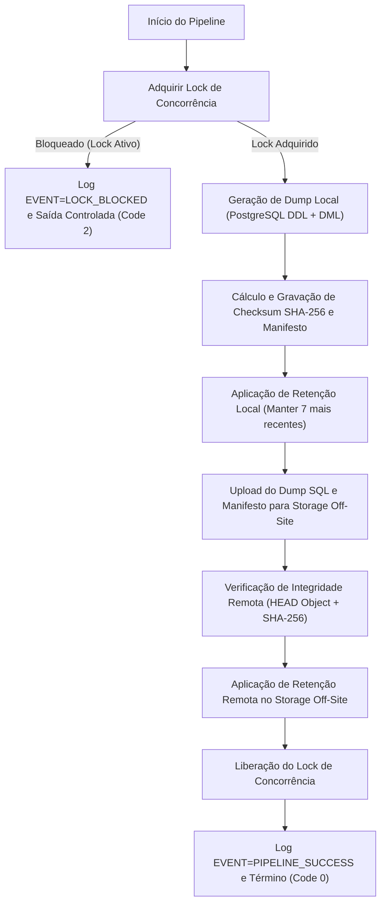

# F17-A.1 — Automação e Monitoramento do Pipeline de Backup

Este documento detalha o funcionamento do pipeline automatizado de backup, sua política de concorrência, o agendamento em nuvem e os eventos de monitoramento estruturados.

---

## 1. Arquitetura do Pipeline (`run-backup-pipeline.js`)

O pipeline consolida em uma única execução atômica todas as etapas necessárias para garantir a segurança dos dados do EuSou:



---

## 2. Agendamento em Nuvem (GitHub Actions)

A automação foi configurada em `.github/workflows/backup-dr.yml`:

- **Gatilho Programado:** Execução diária às `03:00 UTC` (`00:00 Horário de Brasília`):
  ```yaml
  on:
    schedule:
      - cron: '0 3 * * *'
    workflow_dispatch:
  ```
- **Proteção de Segredos:** Todas as connection strings e chaves de acesso são injetadas estritamente via **GitHub Encrypted Secrets**:
  - `DATABASE_URL`
  - `DIRECT_URL`
  - `BACKUP_STORAGE_TYPE`
  - `BACKUP_OFFSITE_ENDPOINT`
  - `BACKUP_OFFSITE_TOKEN`
  - `S3_BUCKET`, `S3_ACCESS_KEY_ID`, `S3_SECRET_ACCESS_KEY` (quando em modo S3)
- **Prevenção de Sobreposição:** `concurrency.group: backup-pipeline` impede que duas execuções do workflow concorram entre si.

---

## 3. Comandos npm Disponíveis

No diretório `backend`:

| Comando | Finalidade |
| :--- | :--- |
| `npm run db:backup` | Gera dump local e manifesto com cálculo de hash SHA-256. |
| `npm run db:backup:offsite` | Executa o pipeline completo (lock + dump + upload off-site + retenção dupla). |
| `npm run db:restore:offsite` | Baixa o backup do storage off-site e restaura em schema isolado com auditoria. |
| `npm run db:integrity` | Compara objeto a objeto entre a base oficial e o schema restaurado. |
| `npm run db:verify-restore` | Executa validação do Prisma CLI no schema restaurado. |
| `npm run db:test-failures` | Roda a suíte de resiliência e simulação de 4 falhas operacionais. |
| `npm run db:vault:start` | Inicia o serviço autônomo de Vault Off-Site. |

---

## 4. Dicionário de Eventos de Monitoramento

Os logs operacionais emitem eventos estruturados no formato `[MONITOR] EVENT=<NOME>` para fácil ingestão em ferramentas de observabilidade (ex: Datadog, CloudWatch, Loki):

| Evento | Significado |
| :--- | :--- |
| `PIPELINE_STARTED` | Início do processo unificado de backup e upload. |
| `LOCK_ACQUIRED` | Trava de concorrência obtida com sucesso pelo PID atual. |
| `LOCK_BLOCKED` | Execução bloqueada porque outro processo de backup já estava ativo. |
| `LOCK_RELEASED` | Trava de concorrência liberada após a conclusão ou falha. |
| `BACKUP_STARTED` | Início da extração lógica do banco de dados PostgreSQL. |
| `BACKUP_SUCCESS` | Dump local concluído, arquivo e manifesto gravados com sucesso. |
| `BACKUP_FAILED` | Erro durante a extração do banco de dados. |
| `UPLOAD_STARTED` | Início do envio do arquivo para o storage remoto. |
| `UPLOAD_SUCCESS` | Envio concluído com sucesso e status HTTP 201. |
| `UPLOAD_FAILED` | Falha de rede, autenticação ou escrita no storage remoto. |
| `VERIFY_SUCCESS` | Confirmação de que o objeto existe no storage remoto com hash intacto. |
| `VERIFY_FAILED` | Objeto não localizado no storage remoto após o upload. |
| `RETENTION_SUCCESS` | Política de retenção aplicada (podas de arquivos antigos concluídas). |
| `OFFSITE_RESTORE_STARTED`| Início do teste de restauração a partir do cofre remoto. |
| `DOWNLOAD_SUCCESS` | Download do backup off-site concluído com SHA-256 idêntico ao remoto. |
| `RESTORE_SUCCESS` | Restauração e auditoria de integridade 100% aprovadas. |
| `RESTORE_FAILED` | Falha no download, corrupção de hash ou erro de integridade referencial. |
